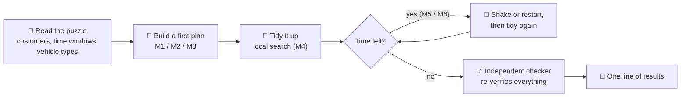
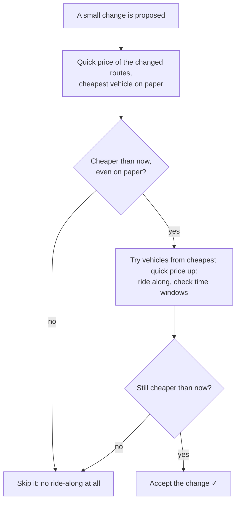
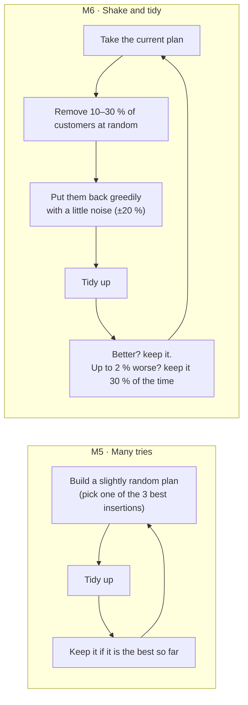
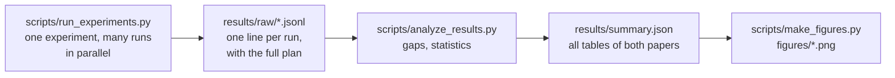

# How it works: a gentle tour of the code

This page explains, in plain words and pictures, what happens inside the solver when you run

```bash
python3 examples/solve.py data/own/RC100_0.json --method M6 --time 4
```

No formulas you have to remember, no need to read the code first. Each section ends with **"In the code"**, pointing to where the idea lives, in case you want to look.

---

## 1. The big picture

Planning a day of deliveries happens in a few calm steps:



- **M1–M3** stop after the first step: they give a plan almost instantly.
- **M4** builds and then tidies once.
- **M5** and **M6** keep improving for as long as you let them.

Whatever happens in the middle, the finished plan always goes through the checker, which trusts nothing.

---

## 2. What a plan looks like

A **plan** is simply a list of **routes**. A route is a list of customers in visiting order, plus the vehicle type that drives it.

```
Plan
├── Route 1   🚐 van    0 → 12 → 7 → 31 → 0      (0 is the depot)
├── Route 2   🚲 bike   0 → 3 → 18 → 0
└── Route 3   🚚 truck  0 → 25 → 9 → 40 → 22 → 0
```

Each route also remembers a few things, so nobody has to recompute them all the time: total weight, total volume, length and cost.

> **In the code:** `Route` and `Sol` in [`hfvrptw/core.py`](../hfvrptw/core.py). A puzzle is an `Instance` from [`hfvrptw/instance.py`](../hfvrptw/instance.py).

---

## 3. The heartbeat: checking one route

Almost everything the solver does comes down to one small question, asked millions of times:

> *"If this vehicle drives these customers in this order, does it arrive on time everywhere, and what does it cost?"*

To answer, the solver rides along the route with a clock:

```
depart 0:00 ──► customer 12  arrive 0:14, window 0:10–1:00  ✓  (unload 10 min)
            ──► customer 7   arrive 0:31, window 0:40–1:30  wait until 0:40  ✓
            ──► customer 31  arrive 1:02, window 0:30–0:55  ✗ too late → route impossible
```

- **Too early:** the vehicle waits.
- **Too late:** the route is impossible.
- **Back at the depot** by the end of the day: the route is fine, and its cost is *price to use the vehicle + price per km × km*.

This ride-along is called a **route evaluation**. Paper [8] counts these evaluations to measure how much work each strategy costs.

**Why the vehicle type matters so much:** a bike is slower, so the same route ridden by a bike reaches every customer later. A route that works for a van can fail for a bike. The type is part of the question, not an afterthought.

**A small twist for the Liu & Shen puzzles:** there the cost is *fixed cost + time on the road*, and waiting counts as time on the road. So the solver also works out how much later it could leave the depot without being late anywhere, and starts that much later. Less waiting means a cheaper route.

> **In the code:** `route_eval` in [`hfvrptw/core.py`](../hfvrptw/core.py). The later-departure trick is the "forward slack" idea of Savelsbergh.

---

## 4. Building a first plan

Three simple "builders" (the papers call them constructive heuristics):

| | Builder | The idea in one picture |
|---|---|---|
| **M1** | Nearest neighbour | 🏠 → closest customer → closest from there → … → home when full |
| **M2** | Savings | start with 🏠→A→🏠, 🏠→B→🏠 …; glue two trips together where that saves the most km |
| **M3** | Insertion with type choice | start a trip at the farthest customer; keep squeezing in the customer that adds the least cost, even if it means switching to a bigger vehicle |

### The trick that makes M3 fast

When M3 wants to squeeze customer *u* between two stops, it must know: *would everyone after u still be on time?* Riding the whole route again for every possible spot would be slow.

So for each route and vehicle type the solver remembers two numbers per stop:

```
stop:            12        7         31
earliest start:  0:14      0:40      0:52     ← "we can't be there earlier than this"
latest start:    0:30      0:45      0:55     ← "any later and someone after us is late"
```

To test a spot, it only computes when *u* would be served and when the next stop would then be reached. If that next arrival is not later than its "latest start", the whole rest of the route is fine. **One quick check instead of a full ride.**

> **In the code:** `nearest_neighbour`, `savings`, `insertion` in [`hfvrptw/construct.py`](../hfvrptw/construct.py). The two arrays are built by `tw_arrays`, and the quick test is `ins_feasible`.

---

## 5. Tidying up: local search

A first plan is never great. **Local search** improves it with small, safe changes, again and again, until no small change helps any more. That end state is called a *local optimum*, and one full tidy-up from start to finish is one *descent*.

Four kinds of small change ("neighbourhoods"):

```
Move a customer          Swap two customers        Swap two tails (2-opt*)     Flip a piece (2-opt)
A: 0-1-2-3-0             A: 0-1-2-3-0              A: 0-1-2 | 3-4-0             0-1-[2-3-4]-5-0
B: 0-7-8-0               B: 0-7-8-9-0              B: 0-7 | 8-9-0               becomes
   ↓ move 2 to B            ↓ swap 2 and 8            ↓                          0-1-[4-3-2]-5-0
A: 0-1-3-0               A: 0-1-8-3-0              A: 0-1-2-8-9-0
B: 0-7-2-8-0             B: 0-7-2-9-0              B: 0-7-3-4-0
```

Three habits keep it fast:

- **Granular:** a customer is only moved next to one of its **20 nearest** neighbours. Moving a customer to the other side of town is almost never a good idea, so those moves are not even tried.
- **First improvement:** as soon as a change helps, it is accepted and the search moves on. It doesn't wait to find the best possible change.
- **Passes:** one pass tries all four kinds of change. Passes repeat until a whole pass finds nothing.

> **In the code:** class `LS` in [`hfvrptw/ls.py`](../hfvrptw/ls.py), with methods `relocate`, `swap`, `two_opt_star`, `two_opt`, and `run` for the loop over passes.

---

## 6. Choosing the vehicle while tidying (paper [8])

Every time a change touches a route, the solver can also ask: *"would this route be cheaper with another vehicle?"* Answering honestly means one ride-along (section 3) **per vehicle type**. That is the expensive part that paper [8] studies.

### The quick price check

Before any ride-along, the solver computes a price that needs no clock at all:

> **quick price = price to use the vehicle + price per km × km**

On our puzzles this *is* the real cost of the route, if it turns out to be possible. On Liu & Shen it is a guaranteed minimum. Either way it tells the solver which options can be skipped:



A worked example. A 20 km route is now on a van: 100 + 1.00 × 20 = **120**.
- 🚚 Truck: quick price 180 + 1.40 × 20 = 208. It can never win, so it is skipped without a ride-along.
- 🚲 Bike: quick price 35 + 0.45 × 20 = 44. If the parcels fit, ride along and check the clock.

**Result of paper [8]:** with this check, trying every vehicle costs only about **3 % more work** than never trying, instead of 63 % more. One full tidy-up needs about 396 ride-alongs instead of 16,779, and the plans come out identical.

### The six habits (strategies)

| Code | When other vehicles are tried during tidying |
|---|---|
| C0 | never |
| C1 | always |
| C2 | not during changes; every 3 passes, every route is re-checked |
| C3 | only for half-empty routes (below 65 % full) |
| C4 | at random, 20 % of the time |
| C5 | at random, 50 % of the time |

`bound=True` switches the quick price check on (the default). `bound=False` gives the "naive" version used for comparison.

> **In the code:** `lower_bound` and `best_type` in [`hfvrptw/core.py`](../hfvrptw/core.py). Inside `LS`, the method `screen` is the quick check, `realise` does the ride-alongs, and `enumerate_for` decides, per strategy, whether to try other vehicles.

---

## 7. Using the remaining time: M5 and M6

When there is time left after one tidy-up, two strategies use it differently.



Both stop when the time budget runs out and return the best plan they have seen. Sometimes keeping a slightly worse plan stops M6 from getting stuck in one local optimum.

> **In the code:** `m4`, `m5` and `ils` in [`hfvrptw/meta.py`](../hfvrptw/meta.py). Greedy put-back is `reinsert` in [`hfvrptw/construct.py`](../hfvrptw/construct.py).

---

## 8. The independent checker

Clever shortcuts (sections 4 and 6) are where bugs like to hide. So every finished plan is checked by a small, separate program that shares **no code** with the methods. Starting from the raw puzzle data, it recomputes:

- the weight and volume of every route against its vehicle;
- every arrival time against every time window;
- the return to the depot before the end of the day;
- that every customer is served exactly once;
- the cost, compared with the cost the method claimed.

All 9,032 published plans passed.

> **In the code:** `check` in [`hfvrptw/checker.py`](../hfvrptw/checker.py).

---

## 9. From runs to tables and figures



- **Repeatable:** every random choice comes from a *seed*, so the same seed always gives the same plan. Our 18 puzzles are generated from fixed seeds too.
- **Resumable:** each run is appended as one line. If an experiment is interrupted, runs already in the file are skipped and it continues where it stopped.
- **Parallel:** runs are spread over several processor cores. Each run itself uses one core, so time budgets are fair.
- **Honest statistics:** to say "method A beats method B", the analysis uses the Wilcoxon signed-rank test over the puzzles, with the Holm correction because many comparisons are made at once.

---

## 10. What we use

| Thing | What for |
|---|---|
| **Python 3**, standard library only | the whole solver: `random` (seeded choices), `math`, `time` (budgets), `json` (input and output), `multiprocessing` (parallel runs) |
| **SciPy** | the Wilcoxon test in the analysis |
| **Matplotlib** | the figures |
| **JSON** files | our 18 puzzles and every result |
| **VRPLIB** files | Solomon's puzzles, read directly |

No external optimisation solver and no compiled code: everything can be read, run and changed with a plain Python installation.

**Ideas we build on:**

| Idea | Source |
|---|---|
| savings method (M2) | Clarke and Wright (1964) |
| test puzzles with time windows, classes R/C/RC | Solomon (1987) |
| mixed-fleet benchmark | Liu and Shen (1999), best-known solutions from Koç et al. (2015) |
| later departure to avoid waiting | Savelsbergh's forward time slack (1992) |
| granular neighbourhoods (nearest neighbours only) | Toth and Vigo (2003) |
| iterated local search (M6) | Lourenço, Martin and Stützle |

---

## 11. Where to go next

- **Try it:** [README → Quick start](../README.md#quick-start)
- **Methods and strategies in more detail, with a Python example:** [`methods.md`](methods.md)
- **The data sets and their formats:** [`data/README.md`](../data/README.md)
- **The experiments and the result format:** [`results/README.md`](../results/README.md)
